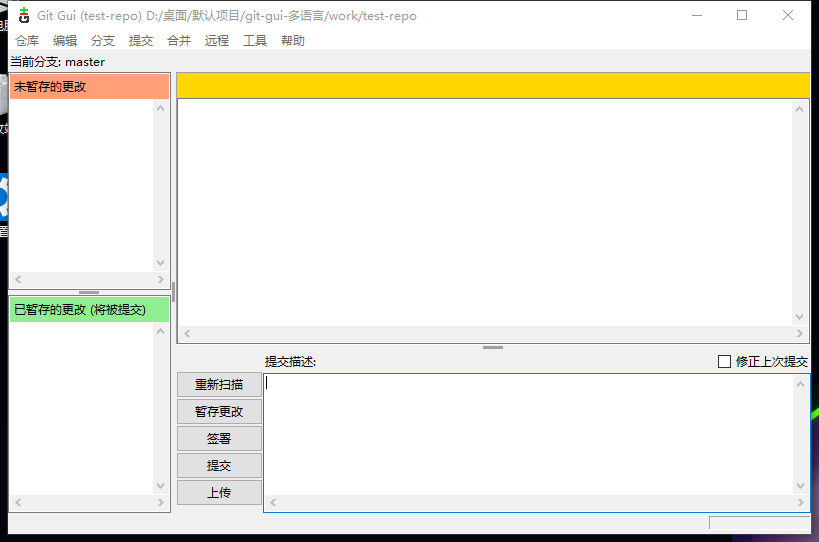
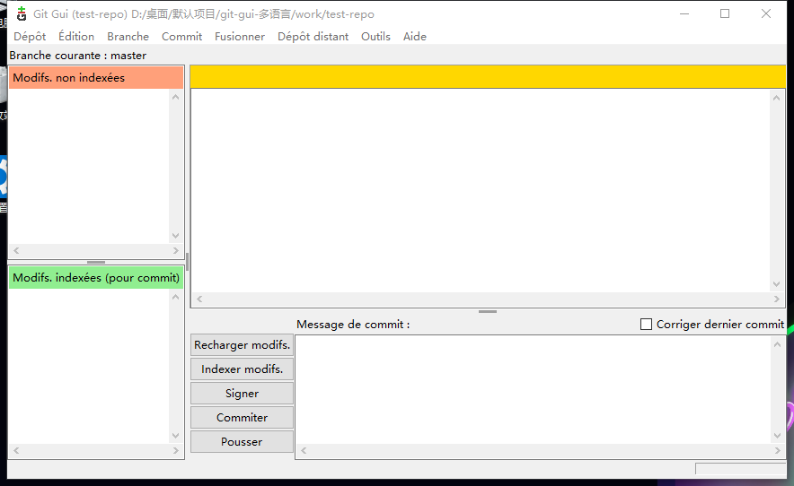
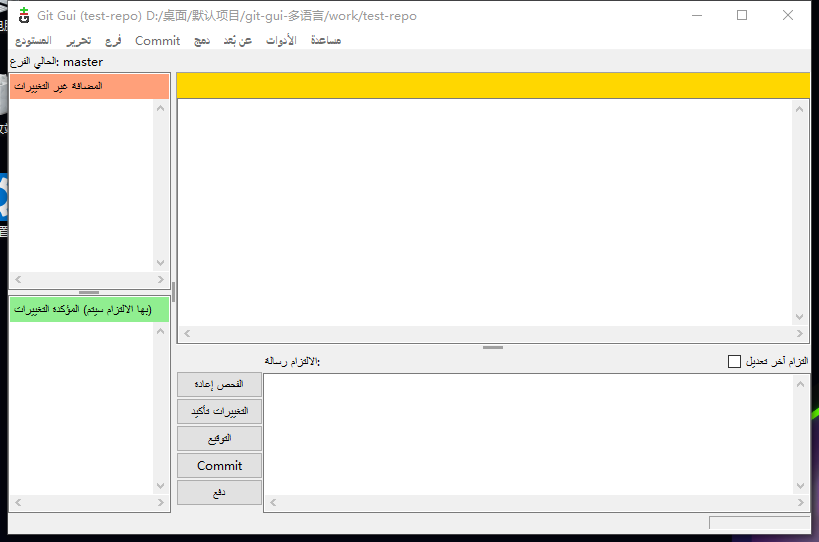

# git-gui Multilingual Pack

**Make Git GUI speak your language — 85 locales for Git for Windows, installed in one click.**

[中文说明](README.zh-CN.md) · [Release guide](GITHUB-发布指南.md)

Git GUI (git-gui) ships with only a small set of translations. This project adds **85 locale files** plus a one-click installer that adapts to both modern and legacy Git for Windows layouts.

It is designed for people who want a localized Git GUI without editing Tcl, compiling anything, or hunting for the right msgs folder.

## Preview

| 简体中文 | Français | العربية |
|:---:|:---:|:---:|
|  |  |  |

## Features

- **85 locales** — 81 languages plus Chinese, Portuguese and Norwegian regional variants.
- **One-click installer** — runs elevated through UAC, backs up the old files, then copies all .msg files.
- **Both Git layouts** — detects ucrt64 (new) and mingw64 / mingw32 (older), plus MSYS2 usr and custom folders.
- **Custom Git path** — drag a Git root, a msgs folder or a git-gui lib folder onto the .bat, or pass it as an argument.
- **No runtime dependency** — pure Tcl msgcat files; Git GUI loads them directly.
- **Automatic quality checks** — placeholders, Tcl escaping, script detection and round-trip validation.

## Install

**Read [INSTALL.md](INSTALL.md) in your language:** English · 简体中文 · 繁體中文 · Español · Français · Deutsch · Português · Русский · 日本語 · 한국어 · العربية · हिन्दी

1. Download the latest release ZIP.
2. Extract it. Do not run the .bat from inside the ZIP.
3. Double-click **install-all-languages.bat**. Click **Yes** when Windows asks for administrator rights.
4. Restart Git GUI. It follows your Windows display language automatically.

**安装所有语言.bat** is a Chinese-named alias for the same installer.

If UAC is denied, right-click the .bat and choose **Run as administrator**.

The installer checks these locations:

| Layout | Folder |
|---|---|
| Git for Windows 2.4x+ (UCRT64) | ucrt64\share\git-gui\lib\msgs |
| Older Git for Windows (MinGW-w64) | mingw64\share\git-gui\lib\msgs |
| Older 32-bit Git | mingw32\share\git-gui\lib\msgs |
| MSYS2 / some distributions | usr\share\git-gui\lib\msgs |
| Custom / portable | <Git root>\...\share\git-gui\lib\msgs |

If the lib folder exists but msgs does not, the installer creates it.

Every install creates a backup next to the target:

    ...\git-gui\lib\msgs_backup_<random>\

## Force a language

Git GUI follows the Windows display language by default.

To test or force a locale:

    set LANG=fr
    git gui

Git Bash:

    LANG=fr git gui

Useful locale codes: zh_cn, zh_tw, zh_hk, zh_sg, fr, de, es, pt_br, pt_pt, ru, ja, ko, ar, sr, sr_latn, ckb.

See [语言覆盖与质量.md](语言覆盖与质量.md) for the full list and [语言加载验证.md](语言加载验证.md) for the per-locale test report.

## Translation quality

| Tier | Locales | Source | Recommendation |
|---|---:|---|---|
| Official human | 14 | Upstream git-gui PO files | Use as-is |
| DeepL + glossary | 27 | DeepL with Git context, glossary and automated QA | Native review welcome |
| Bing + glossary | 40 | Microsoft Bing, glossary and automated QA | Native review welcome |
| Regional variants | 4 | Reuse of the main locale | Use as-is |

Automated checks cover printf placeholders, Tcl string escaping, script mixing, empty or identical fallbacks, and a full re-parse of every generated .msg file.

Low-resource languages (for example my, lo, yo) still show machine-translation artifacts. Contributions from native speakers are very welcome.

## How it works

Each file in msgs/ is a plain Tcl msgcat script:

    ::msgcat::mcset fr "Abort failed." "L'abandon a échoué."
    ##::msgcat::mcset fr "Some untranslated string" ""

Git GUI calls msgcat::mcload on the msgs folder, then looks up strings by locale. No patching of git-gui itself is required.

## Repository layout

    msgs/                        85 .msg translation files
    install-all-languages.bat    one-click installer (recommended)
    安装所有语言.bat              Chinese alias for the same installer
    汉化脚本.bat                  legacy alias
    INSTALL.md                   install guide in 12 languages
    README.md                    English
    README.zh-CN.md              Chinese
    docs/                        screenshots
    LICENSE
    CONTRIBUTING.md
    CHANGELOG.md

## Contributing

See [CONTRIBUTING.md](CONTRIBUTING.md).

The most useful contributions are:

- native-speaker review of a specific locale;
- corrected terminology for Git concepts (repository, branch, remote, stage, commit, merge, checkout, tag, stash);
- bug reports with the locale code, the English source string and a screenshot.

## License

GPL-2.0. The translation files are derived from git-gui and Git translation sources, which are distributed under the GPL-2.0.

## Credits

- git-gui contributors and upstream translators.
- Git for Windows.
- DeepL and Microsoft Bing for machine-translation assistance.
- Everyone who reviews a locale and sends a correction.
